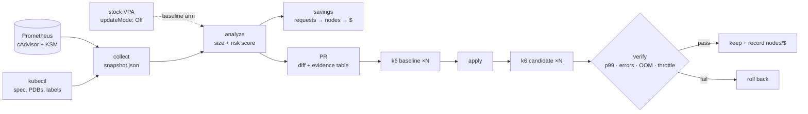

# Rightsized

**Right-sizing tools tell you what to change. Rightsized shows whether the change was safe and whether it saved money.**

VPA, Goldilocks, Kubecost and KRR already compare requests to usage. Their recommendations
mostly go unapplied, because nobody can tell which ones are safe. Rightsized turns
recommendations into **risk-scored pull requests** and verifies each change with a
**before/after load test**. It reports savings at the **node and dollar level**, not just
the request level.

> Results: _not yet measured._ This README will carry a headline number only once it
> comes from the run data committed in `results/`. Until then there is no savings figure here.

## Pipeline



It never mutates the cluster. Collection is read-only, and the PR is the only output.

## What's different

| | Typical recommender | Rightsized |
|---|---|---|
| Output | A number per container | A verdict (🟢 safe / 🟡 review / 🔴 don't touch) with reasons |
| Memory vs CPU | Same percentile + margin | Memory sized from the peak with a wider margin, cut at most 50% per PR; CPU from p95 |
| Failure history | Ignored | OOMKills raise memory above the limit that was hit; throttling freezes CPU cuts |
| Blast radius | Ignored | Replicas, PDB, `rightsized.io/criticality` label |
| Savings | Requests reclaimed | Requests reclaimed **and** nodes removed after bin-packing **and** $/month |
| Delivery | Dashboard or in-place mutation | Pull request against manifests / Helm values |
| Proof | None | Repeated k6 runs before and after, guardrails, rollback |

The full scoring rules are in [docs/methodology.md](docs/methodology.md).

## Quickstart

```bash
make install
make test            # unit tests, no cluster
make offline-demo    # analyze + VPA comparison on a SYNTHETIC snapshot
```

`offline-demo` runs on invented numbers that exercise every code path (OOM, throttling,
short window, blast radius). Its output demonstrates the tool, not results. Don't quote it.

### Full demo on kind (~6h wall clock)

Requires docker, kind, kubectl, helm, k6.

```bash
make demo
```

1. A kind cluster with kube-prometheus-stack and the VPA recommender (recommendation-only).
2. Online Boutique with [developer-guessed requests](deploy/boutique/resources.guessed.yaml):
   oversized almost everywhere, plus a deliberately OOM-prone `adservice` and a throttled `currencyservice`.
3. Seven compressed "days" of [diurnal k6 load](loadtest/diurnal.js) as the observation window.
4. `collect` → `analyze` → `pr` (writes `deploy/boutique/resources.yaml` and `results/pr-body.md`).
5. Baseline: 3 runs of the same load on the guessed values. Candidate: 3 runs after applying the PR.
6. `verify`: medians and run-to-run spread for p99, error rate, OOMs and throttling. On failure, roll back.
7. VPA arm: the same baseline against stock VPA targets, then `compare`.

All raw data lands in `results/`. Commit that directory with any write-up.

Kind nodes have no price and no autoscaler, so node and dollar numbers from kind are
**simulated**. Measured node counts and real billing come from the short cloud run in
[docs/cloud-run.md](docs/cloud-run.md).

## Using it on your own cluster

```bash
rightsized collect --out snapshot.json            # read-only
rightsized analyze snapshot.json
rightsized pr snapshot.json --repo ../gitops --open   # needs `targets:` in rightsized.yaml
```

Copy `rightsized.yaml`, delete the compressed-time `policy` override, and point each
`targets` entry at the manifest (`mode: manifest`) or Helm values path (`mode: helm`,
`path: frontend.resources`) where that container's resources live.

## Results

_Template for after the real run. Every cell must link to a file in `results/`._

| | rightsized | stock VPA |
|---|---|---|
| Containers changed | | |
| Requests reclaimed | | |
| Nodes (measured, cloud run) | | |
| $/month (measured) | | |
| p99 Δ (median of 3) | | |
| Error rate Δ | | |
| OOM events / throttling | | |

## Honesty section

_Fill this in from the run, not before._

- **Load profile:** synthetic diurnal k6 shape. Real traffic has tails, retries and cache effects it doesn't model.
- **Observation window:** compressed time on kind (one "day" = 20 min). A real deployment needs ≥ 7 real days to see a weekly peak.
- **Not measured:** cold starts, JVM warm-up after restarts, node-level noisy neighbours, the latency of autoscaler scale-up during spikes.
- **Where it won't generalize:** clusters already packed by Karpenter consolidation, workloads with CPU limits removed, spot-heavy pools where price ≠ on-demand.
- **Bin-packing model:** first-fit-decreasing is a lower bound. Real schedulers, topology spread and anti-affinity leave more slack.

## Layout

```
src/rightsized/   collect · recommend (size + score) · savings · vpa · gitops · report · verify · cli
deploy/           kind, monitoring, Online Boutique overlay, VPA objects
loadtest/         diurnal k6 script
examples/         SYNTHETIC fixtures for tests and the offline demo
docs/             methodology, cloud-run runbook
```
