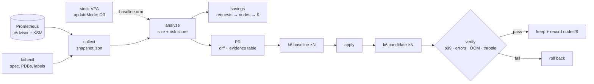

# Rightsized

**Right-sizing tools tell you what to change. Rightsized shows whether the change was safe and whether it saved money.**

VPA, Goldilocks, Kubecost and KRR already compare requests to usage. Their recommendations
mostly go unapplied, because nobody can tell which ones are safe. Rightsized turns
recommendations into **risk-scored pull requests** and verifies each change with a
**before/after load test**. It reports savings at the **node and dollar level**, not just
the request level.

> **Run 1, kind on a GitHub Actions runner** ([raw data](results-published/run-39685034747/),
> [summary](results-published/run-39685034747/SUMMARY.md)): applying stock VPA's recommendations
> made p99 latency **6.3× worse** (32.9 → 208.6 ms) with **8 container restarts** and CPU throttling
> up to **99.9%**. Rightsized's PR reclaimed 3.96 cores and 2.88 GiB of requests with errors, OOMs,
> restarts and throttling unchanged, **but missed its own +10% p99 guardrail by 0.1 ms and rolled itself
> back**. Dollar figures from this run are simulated: kind has no autoscaler and no bill.
> A like-for-like replication (run 2) is in progress.

## Pipeline



It never mutates the cluster. Collection is read-only, and the PR is the only output.

## What's different

| | Typical recommender | Rightsized |
|---|---|---|
| Output | A number per container | A verdict (🟢 safe / 🟡 review / 🔴 don't touch) with reasons |
| Memory vs CPU | Same percentile + margin | Memory sized from the peak with a wider margin, cut at most 50% per PR; CPU from p95 |
| Failure history | Ignored | OOMKills raise memory above the limit that was hit; throttling freezes CPU cuts |
| Blast radius | Ignored | Replicas, PDB, `rightsized.io/criticality` label |
| Savings | Requests reclaimed | Requests reclaimed **and** nodes removed after bin-packing **and** $/month |
| Delivery | Dashboard or in-place mutation | Pull request against manifests / Helm values |
| Proof | None | Repeated k6 runs before and after, guardrails, rollback |

The full scoring rules are in [docs/methodology.md](docs/methodology.md).

## Quickstart

```bash
make install
make test            # unit tests, no cluster
make offline-demo    # analyze + VPA comparison on a SYNTHETIC snapshot
```

`offline-demo` runs on invented numbers that exercise every code path (OOM, throttling,
short window, blast radius). Its output demonstrates the tool, not results. Don't quote it.

### Full demo on kind

Requires docker, kind, kubectl, helm, k6. Or run it without installing anything: the
[`demo` workflow](.github/workflows/demo.yml) runs the whole pipeline on a GitHub runner
(Actions → demo → Run workflow, about 3 h with the defaults) and uploads `results/` as an artifact.

```bash
make demo                         # DAY_MINUTES=20 RUNS=3 by default, ~6 h
DAY_MINUTES=10 PEAK_RPS=25 make demo   # the settings used for the published runs, ~3 h
```

1. A kind cluster with kube-prometheus-stack and the VPA recommender (recommendation-only).
2. Online Boutique with [developer-guessed requests](deploy/boutique/resources.guessed.yaml):
   oversized almost everywhere, plus a deliberately OOM-prone `adservice` and a throttled `currencyservice`.
3. Seven compressed "days" of [diurnal k6 load](loadtest/diurnal.js) as the observation window.
4. `collect` → `analyze` → `pr` (writes `deploy/boutique/resources.yaml` and `results/pr-body.md`).
5. Baseline: 3 runs of the same load on the guessed values. Candidate: 3 runs after applying the PR.
6. `verify`: medians and run-to-run spread for p99, error rate, OOMs and throttling. On failure, roll back.
7. VPA arm: the same baseline against stock VPA targets, then `compare`.

All raw data lands in `results/`. Commit that directory with any write-up.

Kind nodes have no price and no autoscaler, so node and dollar numbers from kind are
**simulated**. Measured node counts and real billing come from the short cloud run in
[docs/cloud-run.md](docs/cloud-run.md).

## Using it on your own cluster

```bash
rightsized collect --out snapshot.json            # read-only
rightsized analyze snapshot.json
rightsized pr snapshot.json --repo ../gitops --open   # needs `targets:` in rightsized.yaml
```

Copy `rightsized.yaml`, delete the compressed-time `policy` override, and point each
`targets` entry at the manifest (`mode: manifest`) or Helm values path (`mode: helm`,
`path: frontend.resources`) where that container's resources live.

## Results

All numbers below are regenerated from the raw files by `python scripts/summarize.py <run dir>`.

**Setup:** GitHub-hosted runner (4 vCPU, 15 GiB), kind with 3 workers, Online Boutique v0.10.2
with [guessed requests](deploy/boutique/resources.guessed.yaml), diurnal k6 load at 25 req/s peak.
One compressed day = 10 min; observation = 7 compressed days. Three 10-minute load runs per arm,
all against the same baseline.

### Run 1 ([39685034747](https://github.com/abhichandra-v/rightsized/actions/runs/39685034747))

| | rightsized | stock VPA |
|---|---|---|
| Containers changed | 9 of 11 (2 held for review) | 11 of 11 |
| Requests reclaimed | 3.96 cores, 2.88 GiB | 4.62 cores, 5.57 GiB |
| Nodes, bin-packing simulation (m6i.large) | 4 → 2 (≈ $140/mo) | 4 → 1 (≈ $210/mo) |
| p99 latency, median of 3 (baseline 32.9 ms) | 36.3 ms (+10.3%) | 208.6 ms (+534%) |
| Error rate | 0.00% → 0.00% | 0.00% → 0.00% |
| New container restarts | 0 | 8 |
| Max container throttle ratio (baseline 3.7%) | 3.8% | 99.9% |
| Guardrail verdict | ❌ p99 (limit 36.2 ms) → rolled back | ❌ p99, restarts, throttling |

### Run 2

_Replication with identical settings and guardrails: in progress._

## Findings

1. **Stock VPA's regression most likely comes from its limit handling, not its request targets.**
   VPA's CPU targets were close to Rightsized's (e.g. frontend 78m vs 70m, cartservice 63m vs 50m). But stock VPA scales *limits* in proportion to
   requests (`RequestsAndLimits`), so a 1-core limit with a 23m recommendation became a 23m limit.
   The smoke run showed adservice's JVM failing its liveness probe 9 times under exactly that. In run 1
   the VPA arm hit 99.9% throttling and 8 restarts while HTTP error rate stayed at 0%. A guardrail
   on error rate alone would have passed it. That is why `verify` also counts restarts and
   unavailable deployments. Run 1 recorded totals only, so it cannot name the containers; run 2
   records per-container attribution to confirm or refute this.
2. **The p99 guardrail is tighter than the noise.** Rightsized's candidate missed by 0.1 ms, while the
   baseline's own three runs ranged 32–48 ms. The pipeline did what it is built to do and rolled back.
   Whether the change actually made the service slower is what run 2 is for. A median-of-3 p99 with
   a 10% threshold is a strict test, and it will sometimes reject a harmless change.
3. **Requests reclaimed and nodes removed are different numbers.** On paper, Rightsized's
   reclaimed requests are worth ≈ $86/mo when each core and GiB is priced as billable; the bin-packing
   simulation says ≈ $140/mo because whole nodes empty out. Neither is a measurement. Only a run with an
   autoscaler and a bill ([docs/cloud-run.md](docs/cloud-run.md)) turns either into a real dollar figure.
4. **The deliberate under-sizings did not fire.** adservice peaked at 88 Mi of its 256 Mi limit
   (no OOM), and currencyservice was throttled 4.9%, just under the 5% warning threshold, so its
   CPU request was lowered (100m → 60m, limit kept at 100m). The guessed values were not as wrong as
   intended at this load.

## Honesty section

- **Not a dollar result.** kind has a fixed node count and no bill. Every $ above is a simulation
  against an m6i.large price that should be checked before quoting. The cloud run is not done.
- **Load profile:** synthetic diurnal k6 shape at 25 req/s peak on a shared 4-vCPU runner. The
  cluster, Prometheus and k6 compete for the same CPUs, so latency includes noisy-neighbour effects.
- **Observation window:** compressed (one "day" = 10 min, a "week" = 70 min). A real deployment needs
  ≥ 7 real days to see a weekly peak, and the risk scorer's defaults require it.
- **Requests vs runtime on kind:** lowering requests does not throttle anything by itself; only limits
  do. On a busy real node, smaller requests also mean a smaller CPU share under contention, which this
  setup barely exercises. JVM startup CPU (adservice) is not modelled by the sizing rule.
- **Small n:** three runs per arm. The guardrail compares medians; the spread is printed next to it.
- **Bin-packing model:** first-fit-decreasing is a lower bound; real schedulers leave more slack.

## Layout

```
src/rightsized/   collect · recommend (size + score) · savings · vpa · gitops · report · verify · cli
deploy/           kind, monitoring, Online Boutique overlay, VPA objects
loadtest/         diurnal k6 script
examples/         SYNTHETIC fixtures for tests and the offline demo
docs/             case study, methodology, cloud-run runbook
results-published/  raw artifacts of published runs + SUMMARY.md regenerated from them
```
