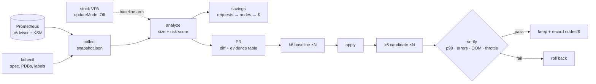

# Rightsized

**Right-sizing tools tell you what to change. Rightsized shows whether the change was safe and whether it saved money.**

VPA, Goldilocks, Kubecost and KRR already compare requests to usage. Their recommendations
mostly go unapplied, because nobody can tell which ones are safe. Rightsized turns
recommendations into **risk-scored pull requests** and verifies each change with a
**before/after load test**. It reports savings at the **node and dollar level**, not just
the request level.

> **Two identical runs on kind** ([run 1](results-published/run-39685034747/SUMMARY.md),
> [run 2](results-published/run-39706701895/SUMMARY.md), raw data alongside): applying stock VPA's
> recommendations made median p99 latency **6.3× and 6.5× worse**, restarted containers 8 times in each
> run and throttled them up to 100%, while HTTP errors stayed at 0%. Rightsized's PR reclaimed about
> 4 cores and 2.9 GiB of requests with no new errors, OOMs or restarts. It **passed every guardrail in
> run 2**, and in run 1 **missed its own +10% p99 limit by 0.1 ms and rolled itself back**.
> Dollar figures are simulated: kind has no autoscaler and no bill.

## Pipeline



It never mutates the cluster. Collection is read-only, and the PR is the only output.

## What's different

| | Typical recommender | Rightsized |
|---|---|---|
| Output | A number per container | A verdict (🟢 safe / 🟡 review / 🔴 don't touch) with reasons |
| Memory vs CPU | Same percentile + margin | Memory sized from the peak with a wider margin, cut at most 50% per PR; CPU from p95 |
| Failure history | Ignored | OOMKills raise memory above the limit that was hit; throttling freezes CPU cuts |
| Blast radius | Ignored | Replicas, PDB, `rightsized.io/criticality` label |
| Savings | Requests reclaimed | Requests reclaimed **and** nodes removed after bin-packing **and** $/month |
| Delivery | Dashboard or in-place mutation | Pull request against manifests / Helm values |
| Proof | None | Repeated k6 runs before and after, guardrails, rollback |

The full scoring rules are in [docs/methodology.md](docs/methodology.md).

## Quickstart

```bash
make install
make test            # unit tests, no cluster
make offline-demo    # analyze + VPA comparison on a SYNTHETIC snapshot
```

`offline-demo` runs on invented numbers that exercise every code path (OOM, throttling,
short window, blast radius). Its output demonstrates the tool, not results. Don't quote it.

### Full demo on kind

Requires docker, kind, kubectl, helm, k6. Or run it without installing anything: the
[`demo` workflow](.github/workflows/demo.yml) runs the whole pipeline on a GitHub runner
(Actions → demo → Run workflow, about 3 h with the defaults) and uploads `results/` as an artifact.

```bash
make demo                         # DAY_MINUTES=20 RUNS=3 by default, ~6 h
DAY_MINUTES=10 PEAK_RPS=25 make demo   # the settings used for the published runs, ~3 h
```

1. A kind cluster with kube-prometheus-stack and the VPA recommender (recommendation-only).
2. Online Boutique with [developer-guessed requests](deploy/boutique/resources.guessed.yaml):
   oversized almost everywhere, plus a deliberately OOM-prone `adservice` and a throttled `currencyservice`.
3. Seven compressed "days" of [diurnal k6 load](loadtest/diurnal.js) as the observation window.
4. `collect` → `analyze` → `pr` (writes `deploy/boutique/resources.yaml` and `results/pr-body.md`).
5. Baseline: 3 runs of the same load on the guessed values. Candidate: 3 runs after applying the PR.
6. `verify`: medians and run-to-run spread for p99, error rate, OOMs and throttling. On failure, roll back.
7. VPA arm: the same baseline against stock VPA targets, then `compare`.

All raw data lands in `results/`. Commit that directory with any write-up.

Kind nodes have no price and no autoscaler, so node and dollar numbers from kind are
**simulated**. Measured node counts and real billing come from the short cloud run in
[docs/cloud-run.md](docs/cloud-run.md).

## Using it on your own cluster

```bash
rightsized collect --out snapshot.json            # read-only
rightsized analyze snapshot.json
rightsized pr snapshot.json --repo ../gitops --open   # needs `targets:` in rightsized.yaml
```

Copy `rightsized.yaml`, delete the compressed-time `policy` override, and point each
`targets` entry at the manifest (`mode: manifest`) or Helm values path (`mode: helm`,
`path: frontend.resources`) where that container's resources live.

## Results

All numbers below are regenerated from the raw files by `python scripts/summarize.py <run dir>`.

**Setup:** GitHub-hosted runner (4 vCPU, 15 GiB), kind with 3 workers, Online Boutique v0.10.2
with [guessed requests](deploy/boutique/resources.guessed.yaml), diurnal k6 load at 25 req/s peak.
One compressed day = 10 min; observation = 7 compressed days. Three 10-minute load runs per arm,
all against the same baseline.

| | rightsized, run 1 | rightsized, run 2 | stock VPA, run 1 | stock VPA, run 2 |
|---|---|---|---|---|
| Containers changed | 9 of 11 | 9 of 11 | 11 of 11 | 11 of 11 |
| Requests reclaimed | 3.96 cores, 2.88 GiB | 4.00 cores, 2.88 GiB | 4.62 cores, 5.57 GiB | 4.69 cores, 5.52 GiB |
| Nodes, bin-packing sim (m6i.large) | 4 → 2 (≈ $140/mo) | 4 → 2 (≈ $140/mo) | 4 → 1 (≈ $210/mo) | 4 → 1 (≈ $210/mo) |
| p99, median of 3 | 32.9 → 36.3 ms (+10.3%) | 29.0 → 31.3 ms (+7.9%) | 32.9 → 208.6 ms (6.3×) | 29.0 → 188.0 ms (6.5×) |
| Error rate | 0% → 0% | 0% → 0% | 0% → 0% | 0% → 0% |
| New container restarts | 0 | 0 | 8 | 8 |
| Deployments not available | 0 | 0 | 0 | 1 (emailservice) |
| Max container throttle ratio | 3.7% → 3.8% | 2.9% → 2.8% | 3.7% → 99.9% | 2.9% → 100% |
| Guardrail verdict | ❌ p99 by 0.1 ms → rolled back | ✅ pass | ❌ 3 guardrails | ❌ 4 guardrails |

Run IDs: [39685034747](https://github.com/abhichandra-v/rightsized/actions/runs/39685034747) and
[39706701895](https://github.com/abhichandra-v/rightsized/actions/runs/39706701895). Same pipeline,
inputs and guardrails; run 2 additionally recorded which containers throttled and restarted.

## Findings

1. **Stock VPA's regression comes from its limit handling, not its request targets.** VPA's CPU
   targets were close to Rightsized's (frontend 78m vs 70m, cartservice 63m vs 50m). But stock VPA
   scales *limits* in proportion to requests (`RequestsAndLimits`). adservice's 1-core limit became
   **23m, below its own observed p99 of 26–32m**, and run 2's attribution shows it throttled 100% and
   restarting. emailservice's 500m limit became 30m and it restarted until it was unavailable. Its
   steady-state usage was 3–4m, so the likely cause is startup CPU, which this setup does not measure.
   Rightsized lowers requests and leaves limits alone.
2. **HTTP errors are the wrong safety signal.** In both VPA runs the error rate stayed at 0% while
   containers were throttled to 100% and crash-looped (adservice is optional to the frontend, so pages
   still rendered). A guardrail on errors alone would have shipped it. `verify` also counts restarts
   and unavailable deployments for this reason.
3. **The p99 guardrail is tighter than the noise, and that is visible.** Rightsized's candidate missed
   by 0.1 ms in run 1 and passed with 0.5 ms to spare in run 2; the baselines' own runs ranged
   32–48 ms and 28–41 ms. A median-of-3 p99 with a 10% threshold will sometimes reject a harmless
   change. The rule was not changed after run 1; replicating under the same rule was the test.
4. **Requests reclaimed and nodes removed are different numbers.** On paper Rightsized's reclaimed
   requests are worth ≈ $86–87/mo with every core and GiB priced as billable. The bin-packing simulation
   says ≈ $140/mo, because whole nodes empty out. Neither is a measurement. Only a run with an autoscaler
   and a bill ([docs/cloud-run.md](docs/cloud-run.md)) turns either into a real dollar figure.
5. **The deliberate under-sizings did not fire.** adservice peaked at 88 Mi of its 256 Mi limit (no OOM),
   and currencyservice's throttling (≈ 2–5% across runs) stayed around the 5% warning threshold. Its CPU request
   was lowered while its 100m limit was kept. At this load the guessed values were not as wrong as intended.

## Honesty section

- **Not a dollar result.** kind has a fixed node count and no bill. Every $ above is a simulation
  against an m6i.large price that should be checked before quoting. The cloud run is not done.
- **Load profile:** synthetic diurnal k6 shape at 25 req/s peak on a shared 4-vCPU runner. The
  cluster, Prometheus and k6 compete for the same CPUs, so latency includes noisy-neighbour effects.
- **Observation window:** compressed (one "day" = 10 min, a "week" = 70 min). A real deployment needs
  ≥ 7 real days to see a weekly peak, and the risk scorer's defaults require it.
- **Requests vs runtime on kind:** lowering requests does not throttle anything by itself; only limits
  do. On a busy real node, smaller requests also mean a smaller CPU share under contention, which this
  setup barely exercises. JVM startup CPU (adservice) is not modelled by the sizing rule.
- **Small n:** three runs per arm. The guardrail compares medians; the spread is printed next to it.
- **Bin-packing model:** first-fit-decreasing is a lower bound; real schedulers leave more slack.

## Layout

```
src/rightsized/   collect · recommend (size + score) · savings · vpa · gitops · report · verify · cli
deploy/           kind, monitoring, Online Boutique overlay, VPA objects
loadtest/         diurnal k6 script
examples/         SYNTHETIC fixtures for tests and the offline demo
docs/             case study, methodology, cloud-run runbook
results-published/  raw artifacts of published runs + SUMMARY.md regenerated from them
```
