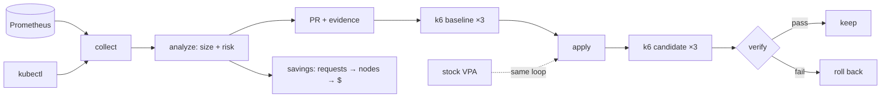

# Rightsized: right-sizing you can verify

**Applying stock VPA's recommendations to a microservices app made p99 latency 6.3× worse and
crash-looped pods, while HTTP errors stayed at zero. A right-sizing change needs proof that it is
safe, not just a number.**

_Every figure here comes from [run 1](../results-published/run-39685034747/SUMMARY.md) and can be
regenerated from the raw files with `python scripts/summarize.py`. A like-for-like replication (run 2)
is in progress; this page is updated when it lands._

## 1. The trust problem

VPA, Goldilocks, Kubecost and KRR all compare requests with usage and print a recommendation. The
hard part is applying it. A platform team looking at "cut cartservice from 500m to 50m" has no way to
tell whether that is safe, whether it will save anything, or how they would know it went wrong.
So most recommendations stay on a dashboard.

Rightsized treats a recommendation as a claim to verify:

- **Risk-scored:** each container gets 🟢 safe / 🟡 review / 🔴 don't touch with reasons (data window,
  variance, OOMs, throttling, restarts, replicas, PDB, criticality).
- **Asymmetric:** memory is sized from the peak with a wider margin and cut at most 50% per PR,
  because under-sized memory kills the pod. CPU is sized from p95; under-sized CPU only throttles.
- **GitOps-native:** the output is a pull request with an evidence table, never a cluster mutation.
- **Closed-loop:** baseline load test → apply → identical load → guardrails → automatic rollback.

## 2. Architecture

## 3. Results card (run 1)

Online Boutique with developer-guessed requests, kind on a 4-vCPU GitHub runner, diurnal k6 load
(25 req/s peak), three 10-minute runs per arm against one shared baseline.

| | rightsized | stock VPA |
|---|---|---|
| Containers changed | 9 of 11 | 11 of 11 |
| Requests reclaimed | 3.96 cores, 2.88 GiB | 4.62 cores, 5.57 GiB |
| Nodes, bin-packing simulation | 4 → 2 | 4 → 1 |
| p99 (baseline 32.9 ms) | 36.3 ms (+10.3%) | 208.6 ms (+534%) |
| Errors | 0% | 0% |
| New restarts | 0 | 8 |
| Max throttling (baseline 3.7%) | 3.8% | 99.9% |
| Verdict | ❌ rolled back: p99 0.1 ms over limit | ❌ rolled back: p99, restarts, throttling |

Neither arm passed. VPA's failure was large and multi-signal. Rightsized's was a 0.1 ms miss on one
guardrail, inside the baseline's own run-to-run spread (32–48 ms), and the pipeline rolled it back
anyway. That is the behaviour you want from a safety check, and it is also why run 2 exists.

## 4. Three findings

**HTTP errors are the wrong safety signal.** The VPA arm served every request successfully while
containers were throttled up to 99.9% and restarted 8 times. Stock VPA scales limits with requests,
so a 1-core CPU limit becomes the recommended 23m. In the smoke run that made adservice's JVM fail its
liveness probe 9 times. Rightsized changes requests and leaves limits alone; `verify` guards restarts
and availability as well as errors.

**Reclaimed requests are not money.** The same change is worth ≈ $86/mo if every reclaimed core
and GiB were billable, ≈ $140/mo if whole m6i.large nodes empty out in a bin-packing simulation, and
$0 until an autoscaler removes a node. On kind it removes none. The real number needs the
[cloud run](cloud-run.md).

**A strict guardrail will sometimes reject a good change.** Median-of-3 p99 with a 10% threshold
rejected a change that moved p99 by less than the baseline's own noise. Loosening the rule after seeing
that result would defeat the point; replicating the run under the same rule does not.

## 5. Limits and next steps

- No real dollars yet: kind has no autoscaler or bill. Next: one short EKS + Karpenter run with
  billing export, then teardown ([runbook](cloud-run.md)).
- Compressed time: a "week" is 70 minutes. Real use needs ≥ 7 real days.
- Shared 4-vCPU runner: cluster, Prometheus and k6 compete for CPU, so latency is noisy.
- The deliberate under-sizings (adservice memory, currencyservice CPU) did not fire at this load.
- Sizing ignores JVM startup CPU.
- Three runs per arm gives low statistical power; more runs or a non-parametric test would help.

## 6. Repo

[github.com/abhichandra-v/rightsized](https://github.com/abhichandra-v/rightsized): `make test` and
`make offline-demo` run in seconds; the `demo` workflow reproduces the whole experiment.
