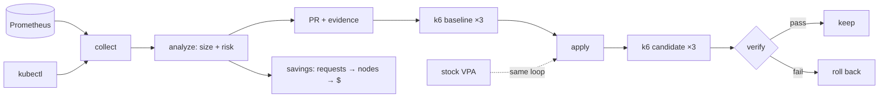

# Rightsized: right-sizing you can verify

**In two identical runs, applying stock VPA's recommendations made p99 latency 6.3× and 6.5× worse and
crash-looped containers, while HTTP errors stayed at zero. Rightsized's change to the same app passed
every guardrail in one run and missed one by 0.1 ms in the other, and rolled itself back when it did.**

_Every figure comes from [run 1](../results-published/run-39685034747/SUMMARY.md) and
[run 2](../results-published/run-39706701895/SUMMARY.md), and can be regenerated from the raw files
with `python scripts/summarize.py`._

## 1. The trust problem

VPA, Goldilocks, Kubecost and KRR all compare requests with usage and print a recommendation. The
hard part is applying it. A platform team looking at "cut cartservice from 500m to 50m" has no way to
tell whether that is safe, whether it will save anything, or how they would know it went wrong.
So most recommendations stay on a dashboard.

Rightsized treats a recommendation as a claim to verify:

- **Risk-scored:** each container gets 🟢 safe / 🟡 review / 🔴 don't touch with reasons (data window,
  variance, OOMs, throttling, restarts, replicas, PDB, criticality).
- **Asymmetric:** memory is sized from the peak with a wider margin and cut at most 50% per PR,
  because under-sized memory kills the pod. CPU is sized from p95; under-sized CPU only throttles.
- **GitOps-native:** the output is a pull request with an evidence table, never a cluster mutation.
- **Closed-loop:** baseline load test → apply → identical load → guardrails → automatic rollback.

## 2. Architecture

## 3. Results card

Online Boutique with developer-guessed requests, kind on a 4-vCPU GitHub runner, diurnal k6 load
(25 req/s peak), three 10-minute runs per arm against one shared baseline, repeated twice.

| | rightsized (run 1 / run 2) | stock VPA (run 1 / run 2) |
|---|---|---|
| Containers changed | 9 / 9 of 11 | 11 / 11 of 11 |
| Requests reclaimed | 3.96 / 4.00 cores, 2.88 GiB | 4.62 / 4.69 cores, ≈ 5.5 GiB |
| Nodes, bin-packing simulation | 4 → 2 | 4 → 1 |
| p99 change (median of 3) | +10.3% / +7.9% | 6.3× / 6.5× |
| Errors | 0% / 0% | 0% / 0% |
| New restarts | 0 / 0 | 8 / 8 |
| Max throttling | 3.8% / 2.8% | 99.9% / 100% |
| Verdict | ❌ rolled back (0.1 ms over) / ✅ pass | ❌ / ❌ |

VPA reclaimed more on paper and failed every time, on several guardrails at once. Rightsized
reclaimed less, held two critical single-replica services back for review, and was within noise of its
p99 limit both times: one miss, one pass.

## 4. Three findings

**VPA's limits, not its targets, broke the app.** VPA's CPU targets were close to Rightsized's.
But stock VPA scales limits with requests, so adservice's 1-core limit became 23m, below its own
observed p99 of 26–32m. Run 2's per-container attribution shows adservice throttled 100% and
restarting, and emailservice (30m limit) restarting until it was unavailable. Rightsized changes
requests and leaves limits alone.

**HTTP errors are the wrong safety signal.** Both VPA runs served every request successfully while
containers crash-looped. adservice is optional to the frontend, so pages still rendered. `verify`
guards restarts and availability as well as errors and latency.

**Reclaimed requests are not money.** The same change is worth ≈ $86/mo if every reclaimed core and
GiB were billable, ≈ $140/mo if whole m6i.large nodes empty out in a bin-packing simulation, and $0
until an autoscaler removes a node. On kind it removes none. The real number needs the
[cloud run](cloud-run.md).

## 5. Limits and next steps

- No real dollars yet: kind has no autoscaler or bill. Next: one short EKS + Karpenter run with a
  billing export, then teardown ([runbook](cloud-run.md)).
- The p99 guardrail sits at the edge of run-to-run noise (baseline runs spanned 28–48 ms). More runs
  per arm, or a non-parametric test, would make the verdict less of a coin toss for small changes.
- Compressed time: a "week" is 70 minutes. Real use needs ≥ 7 real days.
- Shared 4-vCPU runner: cluster, Prometheus and k6 compete for CPU.
- The deliberate under-sizings (adservice memory, currencyservice CPU) did not fire at this load.
- Sizing ignores startup CPU (JVM, Python imports); emailservice's VPA failure suggests it matters.

## 6. Repo

[github.com/abhichandra-v/rightsized](https://github.com/abhichandra-v/rightsized): `make test` and
`make offline-demo` run in seconds; the `demo` workflow reproduces the whole experiment in about 3 hours.
